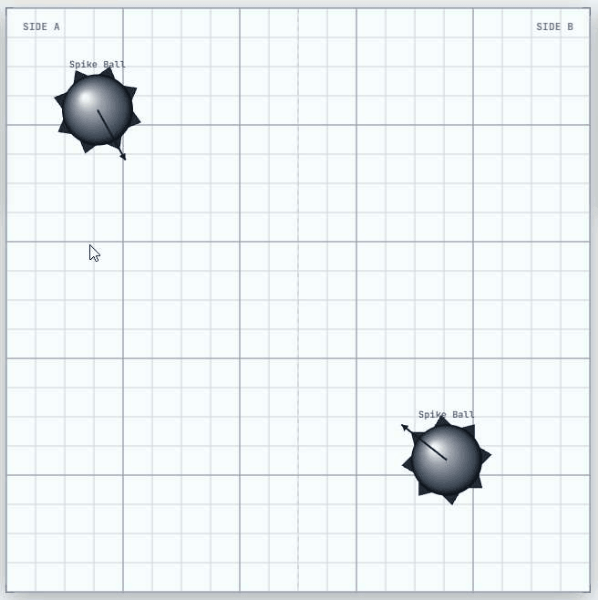
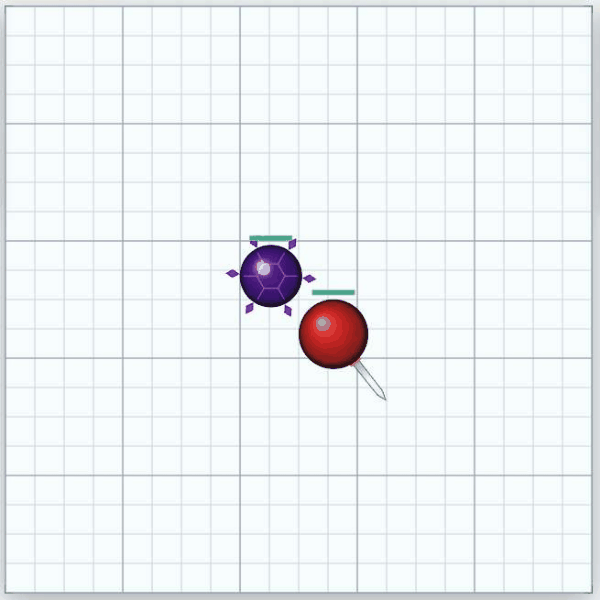
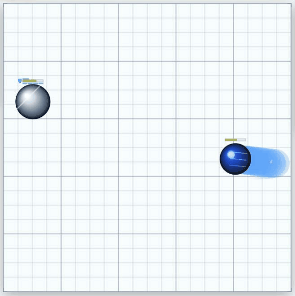

# ⚔️ Ball Battle Simulator

<p align="center">
  
  
  
  
  
  
</p>

An action-packed, 2D physics-driven battle simulator built with **React 19**, **HTML5 Canvas**, **WebGL**, and **Vite**.

Build custom team match-ups, aim trajectory angles, and watch distinct ball classes clash in high-speed, kinetic arena combat featuring specialized weapons, status effects, and real-time physics collisions!

---

## 🎮 Gameplay Showcase

### 🎯 1. Interactive Arena Setup & Aiming
Drag and drop any ball from the roster onto **Side A (Blue)** or **Side B (Red)**. Drag from any placed ball to set its initial launch angle and speed vector, adjust positions freely, or remove balls with a single click before starting the match.

<p align="center">
  
</p>

---

### 💥 2. High-Impact Physics Battles
Once unleashed, balls bounce off perimeter walls and collide with authentic momentum conservation, kinetic knockback, weapon sweeps, and projectile ballistics.

<p align="center">
  
</p>

<p align="center">
  
</p>

---

## 🕹️ Game Controls & How to Play

| Phase | Action | Control |
| :--- | :--- | :--- |
| **Planning** | **Add Ball** | Select any ball from the sidebar roster and click on the arena (Left = Blue, Right = Red). |
| **Planning** | **Aim Trajectory** | Click and drag away from any placed ball to aim its starting launch direction and initial speed vector. |
| **Planning** | **Move Ball** | Drag an existing ball to reposition it within its team's territory. |
| **Planning** | **Remove Ball** | Click the red delete icon on any selected ball or clear all with the Reset button. |
| **Battle** | **Start Battle** | Click **Start Battle** to unleash all balls simultaneously into the arena. |
| **Battle** | **Pause / Resume** | Freeze the action at any moment to inspect current trajectories and health telemetry. |
| **Battle** | **Replay / Reset** | Quick **Retry Battle** with the exact same initial setup or start a fresh match with **New Battle**. |

---

## 🔮 Ball Classes & Rarity Tiers

*6 rarity tiers available — with more ball classes actively on the way!*

- **⚪ Common**: `Normal Ball` `Fast Ball` `Big Ball`
- **🟢 Uncommon**: `Stone Ball` `Heal Ball` `Knife Ball` `Sword Ball` `Spike Ball`
- **🔵 Rare**: `Steel Ball` `Glass Ball` `Hammer Ball` `Grow Ball`
- **🟣 Unique**: `Accelerator Ball` `Gun Ball` `Multi Ball`
- **🌸 Epic**: `Shard Ball` `Thorn Ball`
- **🔥 Legendary**: `Fire Ball` *(and more to come...)*

---

## ⚡ Status Effects & Combat Mechanics

`🩸 Bleed` &nbsp; `🛡️ Shield` &nbsp; `🏋️ Heavy` &nbsp; `🚀 Accelerate` &nbsp; `🎯 Shard Target` &nbsp; `🌿 Thorns` &nbsp; `🧬 Split` &nbsp; `🔥 Burn` &nbsp; `💚 Heal`

> 💡 *Jump into the simulator and open the in-game **Effects & Weapons Codex** to explore full stats, scaling mechanics, and hidden unit passives!*

---

## 🌟 Visual & Audio Polish

- **WebGL LaserFlow Victory Spotlight**: GLSL fragment shader rendering a dynamic golden illumination beam that cradles the solo match victor dead-center upon victory.
- **Real-Time Telemetry HUD**: Interactive health bars, live damage dealt metrics, team survivor counters, and an in-depth victory breakdown card.
- **Searchable Effects Codex**: Comprehensive in-game modal detailing every ball trait, status condition, and weapon attribute.
- **Throttled Sound Suite**: Over 25 spatial sound effects with channel pooling and intelligent cooldown throttling to prevent audio distortion during chaotic clashes.

---

## 🚀 Getting Started

### Prerequisites
- [Node.js](https://nodejs.org/) (v18 or higher recommended)
- `npm` or `yarn`

### Installation & Run

```bash
# Clone the repository
git clone https://github.com/rexshimura/ball-battle-simulator.git

# Enter project directory
cd ball-battle-simulator

# Install dependencies
npm install

# Start local development server
npm run dev
```

Open your browser at `http://localhost:5173` to play!

---

## 📜 License
Distributed under the **Apache License 2.0**. See [`LICENSE`](./LICENSE) for full terms and conditions. Built with passion for retro arcade physics and battle simulators.
